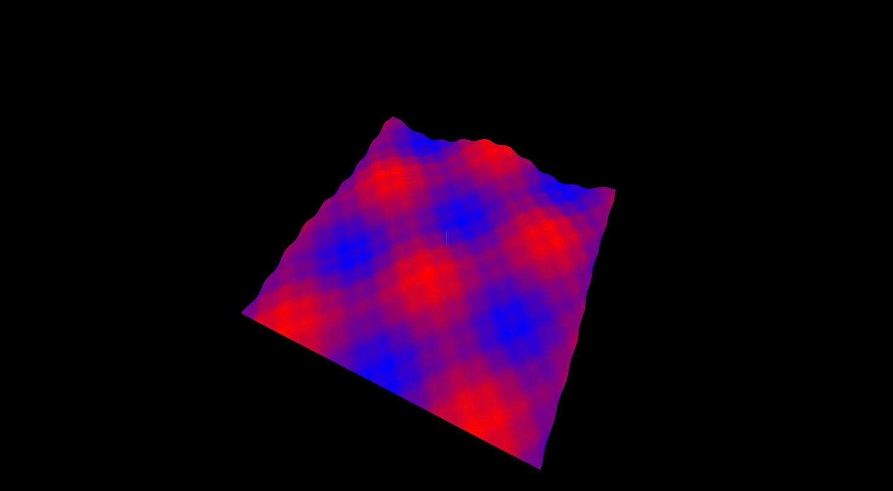

# LiDAR Web Viewer

A learning project: rendering LiDAR-style point clouds in the browser, built step by step from a static synthetic cloud toward streaming real ROS 2 data over a binary WebSocket.



## Stage 1 — static point cloud (done)

- Plain Three.js + Vite + TypeScript, no frameworks on the render path
- ROS convention: right-handed, **Z-up** (`camera.up.set(0, 0, 1)` before OrbitControls)
- Synthetic terrain generated into a flat `Float32Array` (`[x, y, z, x, y, z, ...]`) — the same memory layout the GPU and `sensor_msgs/PointCloud2` use
- `BufferGeometry` + `THREE.Points`, one draw call for the whole cloud
- Custom `ShaderMaterial`:
  - height normalized in the vertex shader via `uMinZ` / `uMaxZ` uniforms
  - blue→red gradient computed on the GPU, passed to the fragment shader as a varying
  - distance-based point size (`gl_PointSize = 40.0 / -mvPosition.z`)

### Performance

Measured with stats.js on an Apple Silicon MacBook (120 Hz display):

| Points | FPS |
|-------:|----:|
| 100k   | 120 (vsync-capped) |
| 500k   | 120 (vsync-capped) |
| 2M     | 120 (vsync-capped) |
| 9M     | 115–120 |

Static geometry + a single draw call means vertex count is nowhere near the bottleneck; the expensive parts are elsewhere (startup CPU generation, and later — streaming buffer updates).

## Roadmap

1. ~~Static point cloud in Three.js~~ ✔
2. Hand-written `sensor_msgs/PointCloud2` parser (`DataView`, field offsets, endianness)
3. Node.js gateway + binary WebSocket framing
4. Live mode: preallocated ring buffer, `setDrawRange`, partial buffer updates
5. Web Worker for socket + parsing; React for HUD only, data stays off React
6. Real-world concerns: reconnect/backoff, data freshness, voxel thinning, int16 quantization
7. Replay a real ROS 2 MCAP recording through the gateway

## Run

```bash
npm install
npm run dev
```
